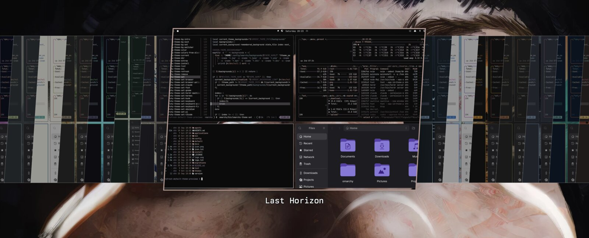

# Theme Switcher

Theme Switcher brings [Omarchy](https://github.com/basecamp/omarchy)'s themes to macOS. Pick a theme from the menu bar or from a full-screen picker, and macOS, your wallpaper, and the apps you work in change to match.



## What a theme changes

Picking a theme applies it to every app below at the same time. Theme Switcher skips an app it can't find: SketchyBar, Rex, and Cursor need their command-line tool, dinky needs `dinky.toml`, and pi and Claude Code need their config folder. The menu warns only about apps that are installed but fail to change.

| App | What changes |
| --- | --- |
| macOS | Light or dark mode, through System Events. |
| Wallpaper | The theme's background on every display. Pick the same theme again to move to its next background. |
| [SketchyBar](https://github.com/FelixKratz/SketchyBar) | Colour variables in `sketchybar.sh`, then `sketchybar --reload`. See [Connect SketchyBar](#connect-sketchybar). |
| dinky | `active-color` and `inactive-color` in the `[borders]` section of `~/.config/dinky/dinky.toml`. |
| Rex | Imports the theme as `Omarchy <Theme>` and sets Rex's colour scheme to light or dark. |
| [Cursor](https://cursor.com) | Installs the theme's own extension, or a generated `Omarchy` theme when there is none, and selects it in `settings.json`. |
| [pi](https://github.com/earendil-works/pi) | Writes `~/.pi/agent/themes/omarchy-system.json` and selects it in `settings.json`. |
| [Claude Code](https://claude.com/claude-code) | Writes `themes/omarchy.json` in `$CLAUDE_CONFIG_DIR` or `~/.claude`, and selects `custom:omarchy` in `settings.json`. |

Before Theme Switcher changes one of your config files for the first time, it copies the original to `~/Library/Application Support/Theme Switcher/backups`.

## Install

You need macOS 14 or later, the Xcode Command Line Tools, and `git`.

1. Clone the repository:

	```sh
	git clone https://github.com/sndrgrdn/theme-switcher.git
	cd theme-switcher
	```

2. Build and install the app:

	```sh
	./scripts/build-app.sh
	```

	The script builds a release binary, installs `Theme Switcher.app` in `~/Applications`, and starts it. A palette icon appears in the menu bar.

3. Wait for the themes to download. On first launch, Theme Switcher fetches the `themes` folder from Omarchy's repository.

The first time a theme switches between light and dark, macOS asks whether Theme Switcher may control System Events. Allow it, or light and dark mode won't change.

To start Theme Switcher when you log in, choose **Start at Login** in its menu.

### Signing

`build-app.sh` signs the app with the identity in `CODESIGN_IDENTITY` when your keychain has it. Otherwise it signs ad hoc.

```sh
CODESIGN_IDENTITY="My Local Signing" ./scripts/build-app.sh
```

macOS keeps permissions such as System Events control for as long as the signing identity stays the same. An ad hoc signature changes with every build, so macOS can ask again after a rebuild.

## Pick a theme

Press <kbd>⌃⌥⌘Space</kbd> to open the picker. Press it again to close it.

| Action | Keys and mouse |
| --- | --- |
| Move through the themes | <kbd>←</kbd> and <kbd>→</kbd>, <kbd>Tab</kbd> and <kbd>⇧Tab</kbd>, the scroll wheel, or a trackpad swipe |
| Filter by name | Type. <kbd>⌫</kbd> deletes a character. |
| Apply the selected theme | <kbd>Return</kbd>, or click the selected card |
| Select another theme | Click its card |
| Close | <kbd>Esc</kbd> clears the filter, then closes. Clicking outside the cards closes too. |

The menu bar icon also lists every theme, and **Update Themes** fetches the latest themes from Omarchy.

Other apps and scripts can use the `theme-switcher` URL scheme:

```sh
open "theme-switcher://picker"
open "theme-switcher://set/tokyo-night"
```

## Add your own themes

Put each theme in its own folder in `~/.config/theme-switcher/themes`. A theme needs a `colors.toml` in [Omarchy's format](https://github.com/basecamp/omarchy/tree/HEAD/themes). It can also have the following files:

- `preview.png`, the image the picker shows.
- `backgrounds/`, with one or more wallpapers.
- `light.mode`, an empty file that marks a light theme. Without it, Theme Switcher uses `mode` from `colors.toml`, or else decides from the background colour.
- `vscode.json`, which names a Cursor extension to install.
- Any file the templates in `Resources/templates` produce, such as `ghostty.conf`. Theme Switcher uses your file instead of rendering the template.

A folder with the same name as an Omarchy theme overrides that theme file by file.

## Connect SketchyBar

Theme Switcher writes colour variables such as `COLOR_BACKGROUND` and `COLOR_ACCENT` to `~/Library/Application Support/Theme Switcher/current/sketchybar.sh`. To use them, source that file from your SketchyBar config:

```sh
THEME_COLORS="$HOME/Library/Application Support/Theme Switcher/current/sketchybar.sh"
[ -f "$THEME_COLORS" ] && . "$THEME_COLORS"
```

## Files

| Path | Contents |
| --- | --- |
| `~/Library/Application Support/Theme Switcher/omarchy` | The Omarchy themes. |
| `~/Library/Application Support/Theme Switcher/current` | The files rendered for the current theme. |
| `~/Library/Application Support/Theme Switcher/state.json` | The current theme and each theme's last background. |
| `~/Library/Application Support/Theme Switcher/apply.log` | One entry per theme switch, with the result for each app. |
| `~/Library/Application Support/Theme Switcher/backups` | Your config files as they were before the first change. |
| `~/Library/Caches/Theme Switcher/previews` | Resized previews for the picker. |

## License

Theme Switcher is released under the [MIT License](LICENSE). The templates, the palette cascade, the template renderer, and the picker design are ported from Omarchy, also MIT licensed. Its notice is in [NOTICE](NOTICE).
